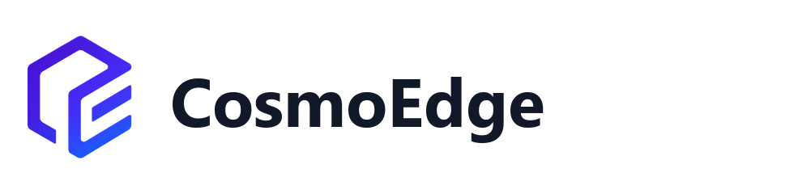

<div align="center">



**Turn video AI models into deployable edge applications — a C++ edge AI engine for Sophon, Rockchip, and x86.**

Build and operate video analytics, VLM, and event workflows through a consistent orchestration experience. Each platform uses its own runtime, build, and model artifacts.

[](https://github.com/cosmo-wander-ai/cosmo-edge/actions/workflows/nightly-build-test-sophon.yml)
[](https://github.com/cosmo-wander-ai/cosmo-edge/actions/workflows/ci-build-rockchip.yml)

[](LICENSE)
[](#core-capabilities)
[](https://github.com/cosmo-wander-ai/cosmo-edge/releases/tag/v1.2.0)

[](https://www.cosmowander.ai/)
[](https://www.cosmowander.ai/docs/)
[](https://gitee.com/cosmo-wander-ai/cosmo-edge)

[Start Here](#choose-your-starting-point) · [Recent Development](#releases-and-recent-development) · [Quick Start](#quick-start) · [Platforms](#choose-a-platform) · [Validation](#validation) · [Documentation](#documentation-devices-and-community) · [简体中文](README.zh-CN.md)

</div>

---

<div align="center">

<https://github.com/user-attachments/assets/23a014a5-d753-432f-8de5-c750bc82d8e2>

</div>

CosmoEdge goes beyond model serving with a complete application layer for model import, visual orchestration, alarms, and event delivery. The core engine and console in this repository are released under Apache-2.0; certified hardware, commercial preset models, and Model Guard distribution protection have separate boundaries.

## Choose Your Starting Point

| Your task | Start here | Project and version |
| --- | --- | --- |
| Deploy video AI applications, configure models, scenes, and alarms | [Quick Start](#quick-start) · [Platforms](#choose-a-platform) | Engine and console in this repository; stable **v1.2.0** |
| Customize an object detector from your data | [CosmoEdge Training Skill](https://github.com/cosmo-wander-ai/cosmoedge-training-skill) | Independent project; published **v0.1.0-preview.1**, with later revisions on its `main` |
| Let an AI assistant query alarms, retrieve images, and request confirmed detection start/stop | [CosmoEdge Connect](https://github.com/cosmo-wander-ai/cosmoedge-connect) | Independent local MCP / WorkBuddy integration; **v0.1.0-alpha.1 source preview** |

The training Skill and Connect are installed and released separately. See [Companion Projects](docs/en/guide/companion-projects.md) for prerequisites, validation scope, and version links.

## Releases and Recent Development

**Stable release: v1.2.0.** Provides separate Open packages for BM1688, CV186X,
RK3576, and RV1126B, plus the x86 Docker development path and Apple Silicon macOS
Docker Preview. Download packages from the [GitHub Release](https://github.com/cosmo-wander-ai/cosmo-edge/releases/tag/v1.2.0)
and check the [1.2 release notes](.github/release-notes/v1.2.0.md) for the platform
boundaries and validation results.

**Changes since v1.1.0** include:

- **Video access:** [ONVIF discovery and authenticated access](docs/en/guide/onvif-access.md), plus [GB28181 device management with TCP/UDP signaling and video access](docs/en/guide/gb28181-access.md).
- **Models and visual workflows:** YOLO26 and oriented bounding-box (OBB) handling; native BM1688 Laya-V model integration, alarm review, and multi-ROI question configuration for images and video. Implementation and completed validation are described in [PR #219](https://github.com/cosmo-wander-ai/cosmo-edge/pull/219).
- **Platform integration:** [Management APIs](docs/en/reference/management.md) for versioned resource delivery, resumable uploads, task start/stop, and state readback.
- **Alarms and console:** Alarm-record deletion, target labels and measured confidence,
  live overlay diagnostics, and refreshed console layouts and themes.
- **Deployment and engineering quality:** RK3576 protected-model handling, model-package validation, video-sample event measurement and VLM evaluation tools, and fixes to task recovery, media handling, log retention, and x86 Docker startup. See the [1.2.0 changelog](CHANGELOG.md).

Consult each feature's documentation for required models and target platforms.
The [v1.1 report](docs/benchmarks/scenario-bench/v1.1/README.md) remains historical
evidence for its recorded candidates and workloads; it does not measure v1.2.0.

## Choose a Platform

CosmoEdge provides one engine architecture and orchestration experience, but each build selects one inference backend and uses models generated for that target platform. The table distinguishes the v1.2.0 package scope from device validation in this release run.

| Platform | Status | Runtime / model artifact | Current scope and evidence |
| --- | --- | --- | --- |
| Sophon BM1688 | v1.2 Open package; device installation, upgrade, and rollback checked | BMRT / `.nn` | The package-bound device result is recorded in the 1.2 release manifest; prior VLM and workload measurements remain in the [v1.1 report](docs/benchmarks/scenario-bench/v1.1/README.md) |
| Rockchip RK3576 / RV1126B | Separate v1.2 Open packages built and audited | RKNN / target-specific `.rknn`; RKLLM on RK3576 | No device validation in this release run; RV1126B does not claim VLM support |
| Sophon CV186X | v1.2 Open package built and audited | BMRT / target-specific `.nn` | No CV186X device validation in this release run |
| x86 Linux / Windows; Apple Silicon macOS | x86 Docker development path; macOS Preview | ONNX Runtime / `.onnx` | Host-specific results are recorded in the 1.2 release manifest; macOS uses amd64 emulation, not native arm64 performance |
| Sophon BM1684X | Planned | — | Not part of the current release scope |

## Quick Start

The commands below clone and build current `main`. For the stable release, use the [v1.2.0 packages](https://github.com/cosmo-wander-ai/cosmo-edge/releases/tag/v1.2.0), or check out the `v1.2.0` tag before building and follow that version's documentation.

### Get the Source

The host needs Git and working Docker; Windows uses Docker Desktop's Linux container mode.
For a new checkout, run the following. For an existing checkout, enter its root instead:

```sh
git clone https://github.com/cosmo-wander-ai/cosmo-edge.git
cd cosmo-edge
```

Run all commands below at the repository root on the host. Select one group for your host
and target chip. Edge-device builds default to Open packages and export artifacts without
starting the application on the build host. See the [Build Guide](docs/en/guide/build.md) for preparation and full steps.

### Try locally on x86

No edge hardware is required. The x86 mode uses the same UI and workflow as edge deployments;
throughput depends on the CPU.

**Linux x86_64 / Bash:**

```bash
./scripts/docker-compose.sh -f docker-compose.x86.yml up -d --build
```

**Windows x86_64 / PowerShell:**

```powershell
docker compose -f docker-compose.x86.windows.yml up -d --build
```

Open `http://localhost:8080` after startup. Artifacts are exported to `build_output/`.
Use the [Scenario Configuration tutorial](https://www.cosmowander.ai/docs/tutorials/02-scenario-config/scenario-config) to create your first AI detection task.

### Apple Silicon macOS Preview

Read the [Mac Preview](docs/en/guide/macos-docker-preview.md) requirements and scope first, then run in the Mac terminal:

```bash
./scripts/macos-docker-preview.sh doctor && ./scripts/macos-docker-preview.sh up
./scripts/macos-docker-preview.sh status
```

Open `http://127.0.0.1:8080` locally. Artifacts are in `build_output/macos-x86/`.
This path uses amd64 emulation for a local, single-video trial.

### Build for Sophon

Select the chip, then the host. The script selects the model resource directory automatically.
The Linux wrapper selects Compose V2/V1 and requests elevation only when Docker access requires
it. The Windows PowerShell entry requires Docker Desktop and Compose V2.

#### BM1688

Linux x86_64 / Bash:

```bash
./scripts/docker-compose.sh -f docker-compose.sophon.yml \
  run --rm cosmo-sophon-package --chip bm1688
```

Windows x86_64 / PowerShell:

```powershell
.\scripts\build_sophon_package.ps1 -Chip bm1688
```

Output: `build_output/public-runtime/bm1688/`.

#### CV186X

Linux x86_64 / Bash:

```bash
./scripts/docker-compose.sh -f docker-compose.sophon.yml \
  run --rm cosmo-sophon-package --chip cv186x
```

Windows x86_64 / PowerShell:

```powershell
.\scripts\build_sophon_package.ps1 -Chip cv186x
```

Output: `build_output/public-runtime/cv186x/`.

Each target directory contains one package, `TARGET_CHIP`, and `SHA256SUMS`. Default Open
packages use plaintext models without device authorization. Verify through the
[Build Guide](docs/en/guide/build.md#hand-a-sophon-build-to-the-deployment-workflow), then install through the
[Deployment Guide](docs/en/guide/deployment.md#ssh-installation-path).

### Build for Rockchip

On a **Linux x86_64 host in Bash**, first pull the shared builder:

```bash
./scripts/docker-compose.sh -f docker-compose.rockchip.yml pull cosmo-rockchip-package
```

Then select one target chip.

#### RK3576

```bash
COSMO_TARGET_CHIP=rk3576 ./scripts/docker-compose.sh \
  -f docker-compose.rockchip.yml run --rm cosmo-rockchip-package
```

Output: `build_output/rk3576/`, using the tracked RK3576 model resources.

#### RV1126B

```bash
COSMO_TARGET_CHIP=rv1126b ./scripts/docker-compose.sh \
  -f docker-compose.rockchip.yml run --rm cosmo-rockchip-package
```

Output: `build_output/rv1126b/`. Default `include` automatically generates and verifies the
model overlay from the platform manifest; no manual preparation is needed. See the
[Build Guide](docs/en/guide/build.md#rv1126b) for default community-model licenses and usage restrictions.

The shared image selects isolated MPP/RGA configurations by chip; only RK3576 packages include
RKLLM v1.3.0. Both targets export chip markers, media-runtime markers, and checksums.
Verify through the [Build Guide](docs/en/guide/build.md#rockchip-artifacts), then use the
[shared installation entry](docs/en/guide/deployment.md#ssh-installation-path).

Controlled Protected builds support BM1688, CV186X, and RK3576; RV1126B is currently unsupported.
See [advanced build options](docs/en/guide/build.md#advanced-build-options) for commands and prerequisites.
Use [CV186X Quick Start](docs/en/guide/cv186x-quick-start.md) for identity checks and first detection,
and [RK3576 Integration](docs/en/guide/rk3576-rknn-development.md) for RKNN model and device boundaries.

## What You Can Build

- **Real-time video analytics:** detection, classification, tracking, zones, counters, OSD, and alarm snapshots.
- **Prompt-driven vision:** VLM state judgment and GroundingDINO open-vocabulary detection alongside conventional CV pipelines.
- **Visual application workflows:** connect models, rules, events, and output actions in the browser.
- **Edge integrations:** operate managed tasks and deliver structured events through REST, WebSocket, MQTT, or HTTP webhooks.

## Core Capabilities

| Capability | What it covers | Go deeper |
| --- | --- | --- |
| Native runtime | C++17 engine for multi-channel media, inference scheduling, OSD, tasks, and events | [Architecture](https://www.cosmowander.ai/docs/guide/architecture) |
| Visual orchestration | Browser-based pipeline composition, task binding, parameter validation, and live feedback | [Pipeline tutorial](https://www.cosmowander.ai/docs/tutorials/04-pipeline-orchestration/pipeline-orchestration) |
| Inference and media | Platform backends for Sophon, RKNN, and x86; platform-specific builds and model artifacts | [Build Guide](https://www.cosmowander.ai/docs/guide/build) |
| VLM and DINO | Prompt-based judgment, open-vocabulary detection, and optional VLM review before a detection alarm is reported | [VLM Guide](https://www.cosmowander.ai/docs/tutorials/03-vlm-guide/vlm-guide) |
| Operations and integration | Model management, alarms, event history, REST, WebSocket, MQTT, and webhooks | [API Overview](https://www.cosmowander.ai/docs/reference/api) |
| Model onboarding and protection | Model conversion, import, validation, and the Open/Protected distribution boundary | [Model Porting Guide](https://www.cosmowander.ai/docs/tutorials/05-model-porting/model-porting) |

<details>
<summary>▶ Watch: compose a complete visual pipeline</summary>

<https://github.com/user-attachments/assets/94b9418b-36c8-47b6-a730-ad8f508a6709>

</details>

<details>
<summary>▶ Watch: GroundingDINO and VLM visual workflows</summary>

<https://github.com/user-attachments/assets/212a33a8-e662-4678-9945-02c78d808e4d>

</details>

## Agent-Assisted Development

Already have a model-porting, integration, or UI task? Give your usual coding agent the business goal, available materials, target device or test environment, and acceptance criteria. The repository provides task entry points, examples, checks, and evidence boundaries so the result can include importable artifacts, scoped code changes, and a verifiable conclusion.

Start with [Agent-Assisted Development](docs/en/development/agent-assisted-development.md), then use the [Model Porting Guide](https://www.cosmowander.ai/docs/tutorials/05-model-porting/model-porting) or [Contributor Guide](docs/en/development/contributing.md) for the task at hand.

## Validation

### CosmoEdge 1.1 multi-platform performance report

The v1.1 report covers BM1688, CV186X, RK3576, and RV1126B. It includes 49 independent small-model case reports for person detection, no-safety-helmet analysis, and a concurrent mixed workload at 5 FPS per business task, a controlled 72-hour dual-CV configured profile, and validated VLM performance for BM1688, CV186X, and RK3576.

- [English benchmark index](docs/benchmarks/scenario-bench/v1.1/README.md)
- [中文基准报告索引](docs/benchmarks/scenario-bench/v1.1/README.zh-CN.md)
- [English primary report (rendered documentation site)](https://www.cosmowander.ai/docs/benchmarks/scenario-bench/v1.1/report.html)
- [72-hour dual-CV report (rendered documentation site)](https://www.cosmowander.ai/docs/benchmarks/scenario-bench/v1.1/results/dual-cv-72h/report.html)
- [Methodology and reproduction](docs/benchmarks/scenario-bench/v1.1/methodology.md)

<details>
<summary>Expand v1.1 candidate identities, performance tables, and test conditions</summary>

The short-run capacity refresh uses source commit `89c73a7464a81ef378686447d7c1eeb88b988455`, tree `6857fbcce72c7af64e6cb23a27e66a405e9df9af`, one fixed 1080p24 input, 30-second steps, and the gates recorded in the [release manifest](docs/benchmarks/scenario-bench/v1.1/release-manifest.json). The 72-hour observation uses source commit `44209759f450e96cda265acfa8bc6d17a1138888`, tree `5cbdefeaefaf642407356c22c271ccc7d57935b0`, and the same controlled input.

| Platform | 72-hour configured channels | Task bindings | Sample coverage | Min / avg FPS | Result |
| --- | ---: | ---: | ---: | --- | --- |
| BM1688 | 8 | 16 | 4316 / 4320 | 4.68 / 5.086 | PASS |
| CV186X | 8 | 16 | 4316 / 4320 | 4.54 / 5.085 | PASS |
| RK3576 | 8 | 16 | 4316 / 4320 | 5.00 / 5.098 | PASS |
| RV1126B | 4 | 8 | 4316 / 4320 | 4.85 / 5.230 | PASS |

These results describe the tested fixed-channel profiles under controlled local-loop input; they are not maximum-capacity or RTSP-resilience measurements. Execution details are documented in the [methodology](docs/benchmarks/scenario-bench/v1.1/methodology.md).

Each channel concurrently runs two business tasks across three model stages: person detection has one detector stage, while no-safety-helmet analysis has a detector followed by a classifier.

| Platform | Workload per channel | Model stages/ch | Target FPS/task | Passing channels | Business-task bindings |
| --- | --- | ---: | ---: | ---: | ---: |
| BM1688 | Person detection + no-safety-helmet analysis | 3 | 5 | ≥16 | 32/32 |
| CV186X | Person detection + no-safety-helmet analysis | 3 | 5 | ≥8 | 16/16 |
| RK3576 | Person detection + no-safety-helmet analysis | 3 | 5 | ≥8 | 16/16 |
| RV1126B | Person detection + no-safety-helmet analysis | 3 | 5 | ≥4 | 8/8 |

The three VLM platforms use one final protocol: each newly added route completes task-local readiness before a 60-second measurement window, and every active route must pass the executed 80% threshold against the 0.1 FPS-per-channel target. Each platform's fixed candidate package also passed model load, task creation, valid inference, event/alarm output, and task recovery after service restart; these claims do not extend to later rebuilt packages.

| Platform | Target FPS/ch | Last passing channels | First failure |
| --- | ---: | ---: | --- |
| BM1688 | 0.1 | 6 channels | 7-channel FPS ratio 69.5%, below the 80% gate |
| CV186X | 0.1 | 6 channels | 7-channel FPS ratio 69.2%, below the 80% gate |
| RK3576 | 0.1 | 4 channels | 5-channel FPS ratio 69.7%, below the 80% gate |
| RV1126B | — | — | Outside this VLM validation |

The capacity values are exact short-run gate boundaries under the recorded conditions—not maximum-capacity certification or production recommendations. The separate 72-hour table verifies only its configured profile. See the [v1.1 benchmark](docs/benchmarks/scenario-bench/v1.1/README.md) for the complete matrices. Previously published data remains available through one [v1.0 historical archive](https://www.cosmowander.ai/docs/benchmarks/scenario-bench/v1.0/) link.

</details>

## Architecture

```text
+------------------------------------------------------------------+
| Web Console | Visual Orchestration | REST / WebSocket / MQTT      |
+--------------------------------+---------------------------------+
                                 |
+--------------------------------v---------------------------------+
| C++ Engine Core                                                   |
| Media | Inference | Tasks | Rules | Alarms | Events | Models      |
+--------------------------------+---------------------------------+
                                 |
+--------------------------------v---------------------------------+
| Inference and Media Backend Interfaces                            |
+--------------------+----------------------+----------------------+
| Sophon BMRT/VPU    | RKNN + MPP/RGA       | ONNX Runtime/FFmpeg  |
| BM1688; CV186X          | RK3576          | x86 Linux / Windows  |
+--------------------+----------------------+----------------------+
```

One build selects one inference backend. Model artifacts are generated for the target platform, and feature/model coverage and capacity remain platform-specific. The public v1.2.0 packages use the Open profile; Model Guard Protected distribution remains a separate path, including the RK3576 source implementation described in [PR #151](https://github.com/cosmo-wander-ai/cosmo-edge/pull/151).

## Documentation, Devices, and Community

| Start here | Best for |
| --- | --- |
| [Documentation Home](https://www.cosmowander.ai/docs/) | Full documentation index and learning path |
| [Quick Start Guide](https://www.cosmowander.ai/docs/tutorials/01-quickstart/quickstart) | First setup and scenario run |
| [Scenario Configuration](https://www.cosmowander.ai/docs/tutorials/02-scenario-config/scenario-config) | Building scene-level workflows |
| [VLM Guide](https://www.cosmowander.ai/docs/tutorials/03-vlm-guide/vlm-guide) | Prompt-based visual judgment and events |
| [Model Porting Guide](https://www.cosmowander.ai/docs/tutorials/05-model-porting/model-porting) | Importing your own model |
| [Agent-Assisted Development](docs/en/development/agent-assisted-development.md) | Delegating an extension task with verifiable results |
| [Companion Projects](docs/en/guide/companion-projects.md) | Training Skill and Connect / MCP prerequisites and independent versions |
| [Changelog](CHANGELOG.md) | Release history and unreleased main-branch changes |
| [Build Guide](https://www.cosmowander.ai/docs/guide/build) | x86, Sophon, and RK3576 build/package paths |
| [API Overview](https://www.cosmowander.ai/docs/reference/api) | REST, WebSocket, MQTT, and webhook integration |

Certified devices add preconfigured acceleration, validated commercial model packages, and dedicated deployment support; they do not unlock separate software features. Devices are available in mainland China from the [Taobao store](https://item.taobao.com/item.htm?id=1066672051450); contact <hello@cosmowander.ai> for other regions or project support.

Contributions are welcome through scoped bug reports, documentation improvements, scenarios, and integration notes. Read [CONTRIBUTING.md](CONTRIBUTING.md) before opening a pull request.

[GitHub Discussions](https://github.com/cosmo-wander-ai/cosmo-edge/discussions) is the official searchable English Q&A and community-support channel for v1.2, and general reproducible defects belong in [GitHub Issues](https://github.com/cosmo-wander-ai/cosmo-edge/issues). Users in mainland China can use [Gitee Issues](https://gitee.com/cosmo-wander-ai/cosmo-edge/issues) for repository access, installation, usage, release downloads, and device-adaptation questions. Code changes and pull requests remain on GitHub; report vulnerabilities privately through [SECURITY.md](SECURITY.md). No Discord channel is operated for this release.

## FAQ

<details>
<summary><b>Can I try CosmoEdge without Sophon or Rockchip hardware?</b></summary>

Yes. Use x86 developer mode on Linux or Windows. Apple Silicon Macs can use the Docker Preview for the console, pipeline, model-management, and integration workflow with one local video. The Mac path uses amd64 emulation and does not enable Model Guard. Edge NPU hardware is still required for target-platform acceleration and capacity validation.

</details>

<details>
<summary><b>What is the boundary between the Open and Protected packages?</b></summary>

They expose the same application features and use the same MD5 upgrade lifecycle. Open uses plaintext models without device authorization; Sophon Protected packages can carry encrypted commercial preset models and provisioning tooling that require a device-bound certificate. Application archives themselves are not signed.

</details>

<details>
<summary><b>Can I use my own trained models?</b></summary>

Yes. For training from data, use the independent [Training Skill](https://github.com/cosmo-wander-ai/cosmoedge-training-skill). For an existing model, use the model-porting path to validate the tensor, preprocessing, post-processing, target runtime, and business accuracy contract. A model artifact must be generated for the platform where it will run.

</details>

<details>
<summary><b>How production-ready is CosmoEdge?</b></summary>

`v1.2.0` provides Open packages for BM1688, CV186X, RK3576, and RV1126B, with a scoped x86 Docker path and macOS Preview. This release run checked BM1688 installation, upgrade, rollback, and data preservation; other chips received build and package audits. The [v1.1 report](docs/benchmarks/scenario-bench/v1.1/README.md) records earlier measured workloads and does not qualify v1.2.0 capacity. Production sizing still requires validation with your own models, streams, accuracy requirements, and deployment conditions.

</details>

### License

CosmoEdge is licensed under the [Apache License 2.0](LICENSE). Copyright 2026 CosmoEdge Contributors.

---

<div align="center">

An open-source project by Cosmo Wander AI and the CosmoEdge contributors.

Turn video AI models into deployable edge applications.

📦 GitHub remains the development and pull-request source of truth. [Gitee](https://gitee.com/cosmo-wander-ai/cosmo-edge) automatically mirrors the code and provides release access and a Chinese issue channel for users in mainland China. See [MIRRORING.md](MIRRORING.md).

</div>
